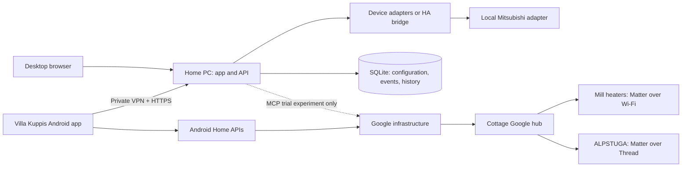

# Tentative architecture

## Requirements and proposals

Confirmed: Finnish UI, desktop access, phone access away from home, server on the owner's normally powered-on Windows 11 PC, home and cottage devices, public project repository. The cottage will not have a computer initially. Essential features must not require a Premium subscription after the speaker's six-month trial.

Owner clarification: Mitsubishi pumps are at the main residence. Cottage behavior should replicate Google Home's remote functionality. Google hub/cloud dependence is accepted and all household mobile devices are Android. Evaluate standard Android Home APIs first. Google Home MCP is retained only as an optional trial experiment, not a required production transport; see [platform decision](platform-decision.md).

Proposed: a native Android integration experiment and a responsive browser desktop interface. Do not commit to a PWA-only client before cottage desktop access passes. One small TypeScript service with SQLite and pluggable adapters is a candidate, not a settled stack. A Python integration service or Home Assistant backend may be a better fit if it substantially reduces adapter work. Avoid microservices until there is a concrete isolation need.

The dotted PC route is an optional experiment; the production PC-to-cottage transport remains unresolved and must work without Premium. Solid Google routes describe documented platform capability, not tests of this hardware. The hub communicates with Wi-Fi devices through the LAN and with Thread devices through its border router. Nothing runs our custom code on the Google speaker or TP-Link routers. No cottage gateway computer is assumed. Direct VPN/REST remains an alternative in [cottage.md](cottage.md).

## Interfaces and state

Use stable internal IDs for Site, Room, Device, Capability, Observation, Command and Schedule. Keep display labels Finnish and protocol identifiers language-neutral. Model each device's supported limits and modes; do not invent capabilities from another device in the same family.

An observation contains value, unit, source timestamp, received timestamp and quality (fresh/stale/unavailable). A command contains ID, actor, target, requested values, expected state version, creation time and expiry. Distinguish accepted, sent, confirmed, failed, expired and uncertain. A successful HTTP response is not physical confirmation.

Adapters expose discovery or manual registration, capabilities, current state, a command operation and health. They translate protocol-specific errors without leaking tokens. Events update the UI over SSE or WebSocket. Read back state where possible; where impossible, clearly show the limitation.

Use explicit set operations instead of toggles, per-device serialization, bounded retries and idempotency keys. Reconcile before retrying a command whose result is uncertain. Do not replay expired heating commands after reconnection. Do not retain MQTT command messages; if MQTT is introduced, use per-device credentials, ACLs and distinct telemetry and command topics.

## Heating and outages

Heaters and heat pumps remain their own thermostats. The first app release changes setpoints; it does not implement a remote control loop that depends on continuous WAN telemetry. Existing physical controls remain available and their changes must appear in the app when the protocol permits it.

For the cottage, device-resident setpoints and any supported local schedules are the only initial autonomous behavior. Verify persistence through internet loss, Wi-Fi loss, PC shutdown and heater power cycling. An ALPSTUGA reading on a disconnected PC cannot provide frost protection. External-sensor regulation is a later feature requiring a local controller or proven device-native support, freshness rules and fallback to the heater sensor.

Choose local schedules or server schedules deliberately to avoid conflicting control. Schedule times use Europe/Helsinki if the owner confirms both sites are in Finland; store events in UTC and define daylight-saving behavior. Manual overrides need an explicit duration or “until changed” policy.

## Remote access and security

Candidate for phone-to-PC access: Tailscale with device ACLs and HTTPS, or a managed WireGuard configuration. Tailscale introduces coordination/relay dependence; decide whether that is acceptable. It does not automatically connect unsupported cottage routers. Plain WireGuard needs a reachable endpoint; if both sites use CGNAT, a public relay/VPS or other network change may be necessary.

Expose only the app through the chosen private network. Device APIs and MQTT should not be forwarded directly to the public internet. Authenticate app users, authorize site access server-side, protect cookie writes from CSRF, and keep device credentials in an OS-protected secret store or restricted external files. PWA offline mode shows dated cached readings and disables control; do not background-queue heating commands.

Back up configuration, database and protocol credentials securely; test restoration before depending on schedules. A Matter controller's fabric credentials are essential for recovery. Backups and logs are private. Keep command audit events with bounded retention; avoid retaining precise occupancy data without a use case.

## Deployment questions

Use Windows 11 as the host baseline. The PC normally stays on; still verify sleep policy, startup without interactive login, firewall scope, recovery after Windows updates and service restart. A service on a sleeping desktop is unavailable. Matter on Windows/container networks requires an early network test; do not choose a container topology that breaks IPv6 or multicast discovery by assumption. Do not introduce a VM or container requirement merely for packaging; choose it only if the selected adapter needs it.

No AI model belongs in the heating command path. Codex helps build and test the software; runtime control should be deterministic and require no model inference. The optional Google Home MCP transport has a separate subscription requirement that must be chosen explicitly.
