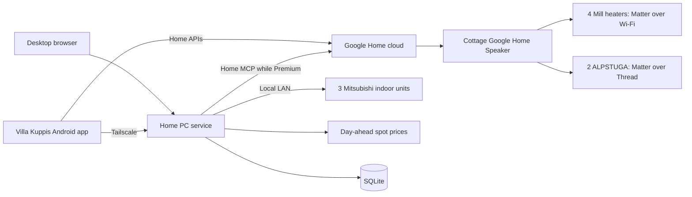

# Tentative architecture

## Decided

- One service on the owner's home Windows 11 PC, which is almost always on. No Home Assistant box, VM or cottage computer; those are a last resort.
- Finnish UI in a desktop browser and on Android phones. All household phones are Android.
- Cottage devices (four Mill heaters, two IKEA ALPSTUGA sensors) are commissioned into Google Home over Matter, with the Google Home Speaker as hub and Thread border router. No Mill or IKEA app or cloud.
- The three Mitsubishi indoor units are at home and are controlled locally from the PC.
- Google Home Premium is available for the speaker's six-month trial. Features that use it need a fallback that works if the owner does not renew.
- Spot-price automation is a high priority. See [spot-price automation](spot-price.md).

## Shape

The PC service owns configuration, history, schedules and the spot-price planner. It talks to the pumps directly and to the cottage through Google: Home MCP while Premium is active, and the [fallback](platform-decision.md) after that. The Android app reads the PC service and can also use the Home APIs directly. Google's own app and [home.google.com](https://home.google.com) remain usable for manual cottage control at any time.

A direct route from the PC to the cottage Matter devices is a secondary research option; see [cottage](cottage.md#secondary-route-direct-matter-from-the-home-pc).

## Stack

Undecided between Python and TypeScript. Python has the most reusable libraries for the likely pump routes (`pymitsubishi`, `aioesphomeapi`). TypeScript has [matter.js](https://github.com/project-chip/matter.js) if the direct Matter route is ever pursued. Choose once the pump route is known. Run the service natively on Windows, started at boot without an interactive login.

## Model

Stable internal IDs for Site, Room, Device and Capability. Finnish display labels; language-neutral protocol identifiers. Store only capabilities a device actually reports.

Each reading has a value, a timestamp and a fresh/stale flag. Each command records who asked, the target, the requested value and its result: sent, confirmed or failed. Show the device's reported state and a pending request separately until the device confirms it. Use explicit set operations rather than toggles, and do not resend a heating command after a reconnect.

Adapters expose discovery or manual registration, capabilities, current state, a set operation and health. The UI gets updates over server-sent events or WebSocket.

## Heating

The devices remain their own thermostats. The app changes setpoints and modes; it never runs a control loop that depends on the network. If the PC or internet is down, devices keep their last setpoint. The Mill heaters also have built-in frost protection that does not depend on Wi-Fi (owner, from the manuals), so the app needs no frost fallback of its own.

Schedules and price plans use Europe/Helsinki local time; store timestamps in UTC.

## Remote access and security

Use Tailscale between the phones and the PC. Expose nothing to the public internet. Keep device and Google credentials outside Git, in the Windows credential store or a restricted local file, and back them up with the database.

No AI model is in the command path. Price plans and schedules are deterministic code.
