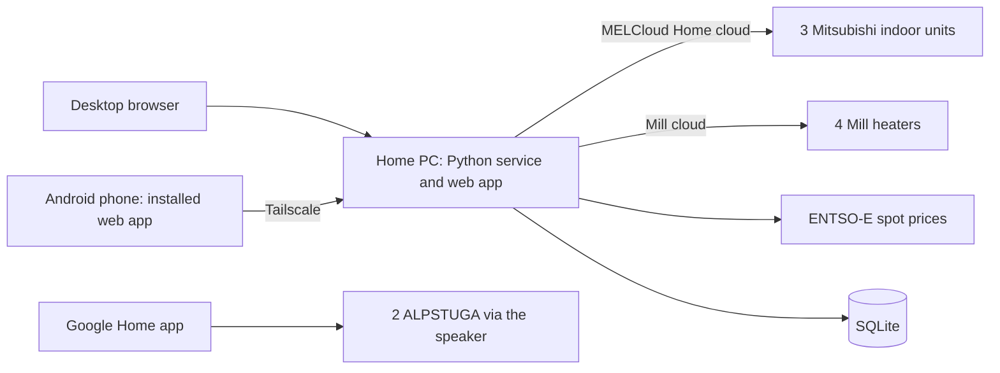

# Tentative architecture

## Decided

- One Python service on the owner's home Windows 11 PC, which is almost always on. No Home Assistant box, VM or cottage computer; those are a last resort.
- One Finnish web app, served by the PC, used from a desktop browser and installed on Android phones' home screens. No native Android app for now.
- The whole idea is one app instead of many. Take the simplest working route to each device, even if it goes through the manufacturer's cloud.
- Home: three Mitsubishi indoor units, controlled through the MELCloud Home cloud. See [Mitsubishi](mitsubishi.md). Their main job is summer cooling; the apartment's radiators are geothermal and outside the owner's control.
- Cottage (devices arriving early November 2026): four Mill heaters in **Mill cloud** mode, controlled through the Mill cloud. The heaters run either Mill cloud or Matter, not both; Mill cloud lets the PC control them directly. Two IKEA ALPSTUGA sensors are in Google Home with the Google Home Speaker as Thread border router.
- Spot-price automation with owner-defined thresholds is a high priority. See [spot-price automation](spot-price.md).

## Shape

The PC service owns configuration, history, rules and plans, and it sends every command. Both sites work the same way: the PC calls the manufacturer's cloud. The ALPSTUGA readings stay in the Google Home app for now; showing them in Villa Kuppis needs a native Android app (a later card).

## Stack

Python for the service: the MELCloud Home client (`aiomelcloudhome`) and the Mill cloud client (`millheater`) are Python libraries. The web UI is served by the same service and works as an installable web app on Android. The service runs natively on Windows and starts at boot without an interactive login.

Both cloud APIs are unofficial: the community reverse engineered them from the manufacturers' apps. If one changes and the library breaks, REA on the current app is the repair tool. Poll gently and send a command only when a setpoint changes.

## Model

Stable internal IDs for Site, Room, Device and Capability. Finnish display labels; language-neutral protocol identifiers. Store only capabilities a device actually reports.

Each reading has a value, a timestamp and a fresh/stale flag. Each command records who or which rule asked, the target, the requested value and its result: sent, confirmed or failed. Show the device's reported state and a pending request separately until the device confirms it. Use explicit set operations rather than toggles.

## Heating and cooling

Devices remain their own thermostats; the app only changes setpoints and modes. If the PC or internet is down, devices keep their last setpoint. The Mill heaters have built-in frost protection that does not depend on Wi-Fi.

Plans use Europe/Helsinki local time; store timestamps in UTC.

## Remote access and security

[Tailscale](https://tailscale.com/pricing) connects the phones to the PC. Its free Personal plan should cover this: recent reports say it has allowed six users and unlimited personal devices since April 2026; confirm on the pricing page. Install it on the PC and each phone and sign in with the same account. Nothing is exposed to the public internet.

Keep the MELCloud Home and Mill account credentials outside Git, in the Windows credential store or a restricted local file, and back them up with the database.

No AI model is in the command path. Rules and plans are deterministic code.
