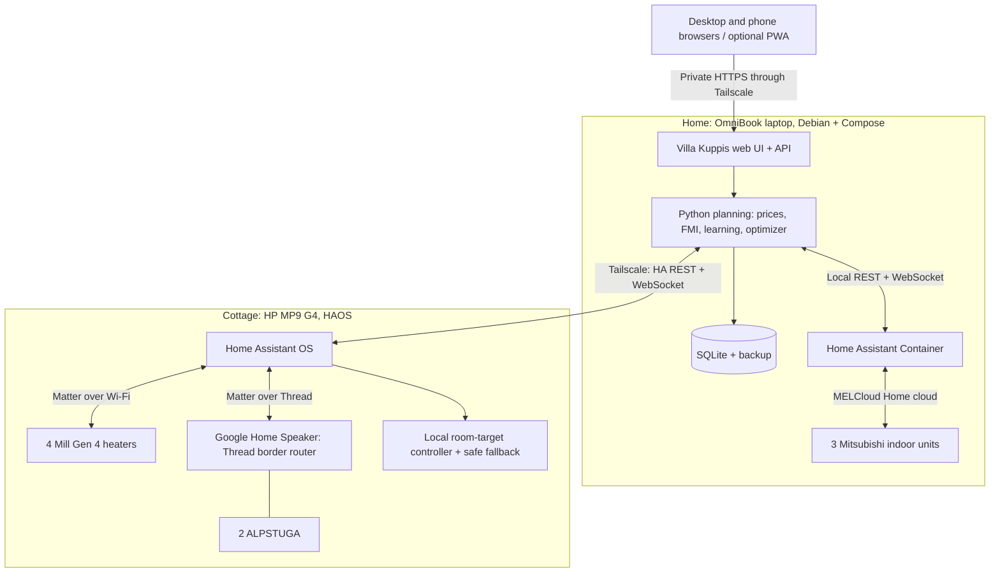

# Architecture

Revised on 20 October 2026 to the two-site Home Assistant design (card H1.1). The earlier Windows PC + Android app design is described in [platform decision](platform-decision.md#superseded-android-and-google-home-route); the Windows installation keeps running until the home cutover (H1.5) passes.

## Decided

- Villa Kuppis is the one Finnish application for controlling, monitoring and optimizing the home and the cottage. Household members use it in a browser, optionally installed as a PWA. No APK.
- One Home Assistant per site is the device gateway and local fallback controller. Home Assistant UIs are for administration and emergencies, not the household's daily app.
- Two always-on x86-64 machines (bought 20 October 2026, not yet arrived):
  - **Home:** an HP OmniBook laptop (Ryzen AI 5 340, 16 GB, 512 GB NVMe) running Debian + Docker Compose with Villa Kuppis, Home Assistant Container and a host-level Tailscale client.
  - **Cottage:** an HP MP9 G4 mini-PC (Core i3-8100T, 8 GB, 256 GB NVMe, Ethernet) running Home Assistant OS with its Matter Server and Tailscale apps.
- Home pumps: Home Assistant's MELCloud Home integration after a parity test (H1.3). The direct `aiomelcloudhome` client stays as the rollback path until then.
- Cottage: four Mill Gen 4 heaters (Matter over Wi-Fi) and two IKEA ALPSTUGA sensors (Matter over Thread) controlled locally by the cottage Home Assistant. The Google Home Speaker (2026) stays as Thread border router and secondary controller.
- Villa Kuppis owns prices, forecasts, learning, plans, visits, history and settings. Each Home Assistant owns pairing, actual device state and immediate commands. The cottage Home Assistant also owns the local safe fallback.
- No inbound ports, no public Home Assistant, no paid services. Tailscale (free plan), Elering and FMI.

The goal stays the same: one app instead of many, the simplest working route to each device, and no AI in the command path.

## Shape

Tailscale connects Villa Kuppis to the cottage Home Assistant's API, not to individual devices. Each Matter fabric stays inside its own site; nothing is routed across the internet except the API connection.

## Ownership

| Concern | Owner | Notes |
| --- | --- | --- |
| Device pairing, capabilities, physical state, immediate commands | Each site's Home Assistant | One writer per thermostat; no competing Google or Mill schedules |
| Prices, forecast, learning, optimization, visits, planned targets | Villa Kuppis (home) | Existing Python modules; deterministic code |
| Safe maintenance temperature, sensor-validity watchdog, fallback targets | Cottage Home Assistant | Works without the home server, Tailscale, the internet or a phone |
| Long-term history, graphs, event log, settings | Villa Kuppis | Home Assistant's recorder only keeps short diagnostic history |
| Remote user identity and access | Tailscale + Villa Kuppis | Tailnet membership is not the same as per-user permission; see [Users](#users) |

**Precedence:** device safety → manual override → active visit → economic plan. The optimizer must not immediately undo a person's change.

## Rooms

| Site | Room | Devices |
| --- | --- | --- |
| Cottage | Large room | Mill heaters 2 × 1050 W and 1 × 500 W, one ALPSTUGA |
| Cottage | Small room | Mill heater 1 × 1050 W, one ALPSTUGA |
| Home | Three rooms | One Mitsubishi indoor unit each |

The ALPSTUGA readings are measurement inputs, not safety thermostats. The heaters' own thermostats still enforce an upper bound.

## Device gateway

A small `DeviceGateway` interface (card H1.2) covers what the product uses:

- discover and bind entities to Villa Kuppis devices (read-only, explicit per site)
- snapshot and subscribe to state changes (WebSocket, with reconciliation after a disconnect)
- request a command and track it as pending, confirmed, failed or unknown
- health and last contact.

Stable Villa Kuppis IDs stay separate from Home Assistant `entity_id` strings, and the mapping is stored. A missing or renamed entity is a clear mapping error; a command must never silently reach a different device. The existing pump client can implement the same interface until H1.5. No plugin system or event bus.

## Cottage control

Villa Kuppis computes each room's effective target for every 15-minute period (prices, forecast, fixed thresholds, later the optimizer, visits). When the target changes it writes it to the room's Home Assistant helper with a heartbeat and revision. After a reconnect it reads actual states and sends only the currently valid target; missed periods show as gaps.

The cottage Home Assistant runs one local controller per room (card H2.2):

- reads the ALPSTUGA, compares it with the stored target and sets the room's heaters with hysteresis, clamping to the heater's supported range, minimum dwell and a bounded command rate;
- **watchdog:** a missing heartbeat, a stale target or a stale/implausible sensor falls back to the safe maintenance setpoint on the heaters' own thermostats; the same applies after a Home Assistant restart before a fresh target arrives;
- keeps working when the WAN, Tailscale, the home server or every phone is down.

Mill heaters also have built-in frost protection. There are no water pipes. A cached whole-day plan at the cottage is not part of the first version (later card H3.3).

**`Automaatio` switch:** off stops economic control (prices, optimizer). The cottage's local safe fallback keeps running. The exact wording is an open owner question.

## Home control

The pump automation logic stays in Villa Kuppis (`cooling.py`, `optimizer.py`, away and night mode): cooling only, never changes a mode, minimum off time. With H1.5 its commands go through Home Assistant's `climate` entities instead of the direct client; `climate.turn_off`/`turn_on` semantics are checked in H1.3 first. Home Assistant polls the MELCloud Home cloud about every 60 seconds; the plan loop must accept that update rate.

## History and graphs

Villa Kuppis stores every reading as a time series in SQLite and keeps it all.

| Series | Source | Interval |
| --- | --- | --- |
| Room temperature, setpoint, mode, fan, on/off: each pump | Home Assistant (today: direct MELCloud Home client) | On change, plus a periodic snapshot |
| Pump energy, if exposed | MELCloud Home measurements | As reported |
| Temperature, CO2, PM2.5, humidity (as exposed): each ALPSTUGA | Cottage Home Assistant | On change |
| Temperature, setpoint, mode: each Mill heater | Cottage Home Assistant | On change |
| Heater power or energy | Matter energy measurement if exposed; otherwise labelled as an estimate | 15 minutes |
| Outdoor temperature and forecast: both sites | FMI open data | Hourly |
| Spot price (15-minute periods) | Elering | Daily after 14:25 and on demand |
| Plan targets, commands, results, site connectivity | Villa Kuppis | Every change |

Graphs per room and per site over a day, week, month or year; prices, setpoints and outdoor temperature share the time axis. Gaps from outages show as gaps. Estimated energy is labelled as an estimate.

## Model

Site, Room, Device and Capability with stable internal IDs; Finnish display labels; language-neutral protocol identifiers; only capabilities a device actually reports. Each reading has a value, a source timestamp and a fresh/stale flag. Each command records who asked (`user`, `Suunnitelma`, site fallback or Home Assistant), the target, the requested value, a request ID and its result. Reported state and a pending request are shown separately until the device confirms.

Plans use Europe/Helsinki local time, including the 92- and 100-period daylight-saving days; timestamps are stored in UTC.

## Deployment

**Home (H1.4):** Villa Kuppis and Home Assistant Container as separate Compose services with pinned versions, persistent volumes and restart policies. Villa Kuppis reaches Home Assistant on a local endpoint; no Home Assistant port is published. Host-level Tailscale publishes only the Villa Kuppis UI with Serve. Windows-only pieces (Task Scheduler, Credential Manager, `%LOCALAPPDATA%`, the PowerShell update script) move behind OS-neutral configuration and secrets; Windows development keeps working. Backups go off the SSD.

**Cottage (H2.1):** HAOS on the HP MP9 G4, wired to the Archer BE230; the NE200-Outdoor provides the 5G uplink (carrier NAT is fine for Tailscale). Local IPv6 and mDNS on a non-isolated LAN. BIOS set to power on after AC loss. Built-in Home Assistant backups, copied off the device.

**Before wiping Windows on either machine:** boot a Debian live USB (home) or the HAOS installer (cottage) and check that networking, storage and the power-on settings work. Installing Debian or HAOS erases the previous system.

**Home laptop as a server:**
- **Network:** prefer wired Ethernet, through a USB-C adapter if the laptop has no RJ45 port; Wi-Fi works but is less dependable for a server.
- **Lid closed:** set `HandleLidSwitch=ignore` (and the docked/external-power variants) in `/etc/systemd/logind.conf`, so closing the lid does not suspend the machine. Disable suspend and hibernate.
- **Battery:** the battery bridges short power cuts like a small UPS. If the BIOS offers a charge limit or battery-health mode, turn it on, since the laptop stays plugged in all the time. Check now and then that the battery is not swelling.
- **Kernel:** the Ryzen AI 300 series is recent hardware; if Debian's stock kernel misses the Wi-Fi or graphics driver, use the Debian backports kernel.
- **Restart after power loss:** a laptop does not usually power on by itself after the battery runs flat. Check for a BIOS option (for example power-on when AC is connected) and otherwise accept that a long outage needs a button press.

**Cottage HP MP9 G4:** set the HP BIOS to power on after AC loss, wire it to the BE230, and keep it somewhere dry; the cottage stays at about 5 °C in winter, which is within normal operating range, but avoid condensation when warming up from cold.

## Remote access and security

Phones and the desktop reach Villa Kuppis through [Tailscale](https://tailscale.com/pricing) with Serve; nothing is exposed to the public internet. The cottage Home Assistant is reachable only from the home server over the tailnet, ideally limited by Tailscale access rules.

- Each Home Assistant is a separate controller with its own credentials. Villa Kuppis uses a site-specific long-lived access token, stored outside Git and outside user-visible backups, with rotation and revocation documented.
- Identity: today's Tailscale `Tailscale-User-*` header trust was designed for Windows localhost; after the move to a container it must be re-checked (Host, Origin, proxy trust, CSRF) before it is relied on.
- A partly work-managed phone may not allow Tailscale; test it. If it is blocked, an authenticated HTTPS gateway for Villa Kuppis alone is a separate later feature, not a reason to weaken security.
- Backups contain personal history but not secrets.

## Users

Household members use Villa Kuppis with full control, without a separate app login; the event log names them through Tailscale identity. Matter commissioning needs a phone or tablet app (Home Assistant Companion or Google Home), not the PWA. Google Home stays usable as a secondary controller and for voice, without competing heating schedules.
