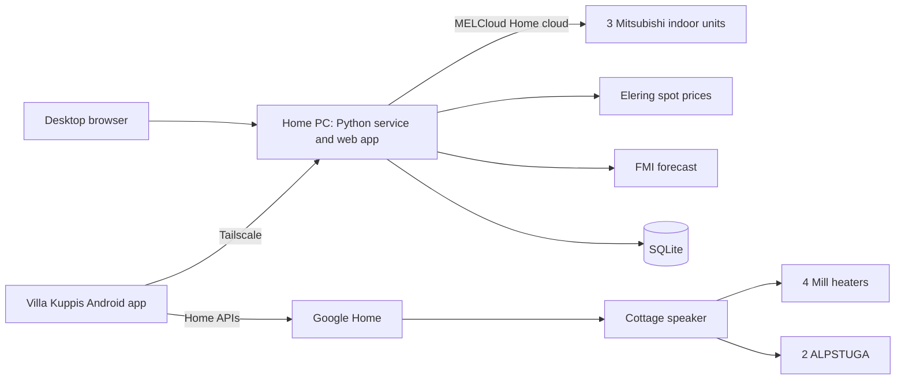

# Architecture

## Decided

- One Python service on the owner's home Windows 11 PC, which is almost always on. No Home Assistant box, VM or cottage computer; those are a last resort.
- One Finnish web app served by the PC, for the desktop browser. One native Kotlin Android app that shows the same web app inside it and adds the cottage functions that need Google Home.
- The goal is one app instead of many. Take the simplest working route to each device, even through the manufacturer's cloud.
- Home: three Mitsubishi indoor units, all in MELCloud Home, controlled from the PC through the MELCloud Home cloud. Their main job is summer cooling; the apartment's radiators are geothermal and outside the owner's control.
- Cottage (devices arriving early November 2026): four Mill heaters and two IKEA ALPSTUGA sensors in Google Home over Matter, with the Google Home Speaker as hub. The heaters follow the ALPSTUGA readings rather than their own sensors.
- Spot-price automation is a high priority: fixed thresholds first, then an optimizer. Home cooling ships first, because the pumps are available now. See [spot-price automation](spot-price.md).
- Every setting (thresholds, temperatures, prices, away and night settings) has a default and can be changed in the app.
- Household members use the app with full control, each with their own Google account. No separate app login.
- No paid services, stores or signing: free Google Cloud project and OAuth setup without billing, a self-signed Android APK installed directly, free Tailscale, Elering and FMI.

## Shape

**The PC** holds configuration, history, rules, prices, the forecast and every plan. It controls the pumps directly.

**The PC cannot reach Google Home.** Google offers its device API only to Android and iOS apps signed in as the user. The only route for PC programs is Home MCP, which needs Premium Advanced and is US-only; the speaker includes Premium Standard. So the PC never reads or writes cottage devices itself.

**The Android app** is the cottage link. It:

- reads cottage readings through the Home APIs and reports them to the PC about every 15 minutes, for graphs and the optimizer (Android may stretch this in battery saver; gaps show in the graphs);
- fetches the cottage plan from the PC and uploads it as Google Home automations, once a day after the 14:25 price fetch, plus a manual re-send button (on the owner's phone only);
- starts and ends visit heating;
- shows notifications.

Google runs the uploaded automations, so the cottage follows its plan with the PC and phone off. Manual control through the Google Home app also works at any time, including when the PC is down.

## Rooms

| Site | Room | Devices |
| --- | --- | --- |
| Cottage | Large room | Mill heaters 2 × 1050 W and 1 × 500 W, one ALPSTUGA |
| Cottage | Small room | Mill heater 1 × 1050 W, one ALPSTUGA |
| Home | Three rooms | One Mitsubishi indoor unit each |

## Stack

- **PC:** Python 3.13, SQLite and a Finnish web app served by the standard-library HTTP server. Pumps use `aiomelcloudhome` 0.3.1; `tzdata` supplies Europe/Helsinki on Windows. The weather client uses the standard library. The unattended runner reads Windows Credential Manager under the owner's account; a password-backed Windows boot task runs it without an interactive login. Tailscale Serve supplies the remote user's identity. Deployment and before-login startup require the F3.2 live checks.
- **Android:** Kotlin with the Google Home APIs; the web app is shown in a WebView.
- **Shared data:** spot prices from Elering's public API and the outdoor forecast from FMI open data. Neither needs a key; both were tested from a cloud session on 18 October 2026.

The MELCloud Home client is unofficial; if it breaks, REA on the current app is the repair tool.

## History and graphs

The PC stores every reading as a time series in SQLite and keeps it all; a few years of data at these rates is small.

| Series | Source | Interval |
| --- | --- | --- |
| Room temperature, setpoint, mode, fan, on/off: each pump | MELCloud Home: its realtime stream where available, otherwise polling | 5 minutes, plus every change |
| Pump energy use, if exposed | MELCloud Home measurements | As reported |
| Room temperature, CO2, PM2.5, humidity, as exposed: each ALPSTUGA | Android app, through the Home APIs | About 15 minutes |
| Temperature, setpoint, mode: each Mill heater | Android app, through the Home APIs | About 15 minutes |
| Heater power or energy | Matter energy measurement if the heaters expose it; otherwise estimated from heating time × rated power | 15 minutes |
| Outdoor temperature: both sites | FMI observations (no key) | Hourly |
| Spot price (15-minute periods) | Elering | Fetched daily at 14:25 for the next day, and on demand with a button |
| Plan targets, commands and their results | PC | Every change |

The web app draws the series as graphs per room and per site, over a day, week, month or year. Prices, setpoints and outdoor temperature share the time axis, and energy and cost (energy × spot price) can be shown per day.

Cottage history starts when the Android app starts recording; Google Home does not hand over past readings. Gaps appear when Android delays the background job or the phone is offline, and the graphs show them as gaps rather than drawing a line across.

## Model

Stable internal IDs for Site, Room, Device and Capability. Finnish display labels; language-neutral protocol identifiers. Store only capabilities a device actually reports.

Each reading has a value, a timestamp and a fresh/stale flag. Each command records who or which plan asked, the target, the requested value and its result. Show the device's reported state and a pending request separately until the device confirms it.

## Heating and cooling

Devices remain their own thermostats; plans only change setpoints, on/off and fan, never the mode. Every automation acts on measured room temperatures, so idle seasons take care of themselves: the cottage heaters do nothing when the room is already warm, and pump automation is cooling-only and leaves alone any unit not in cooling mode. The installed service runs the plan loop and a daily spot-price fetch itself; a master switch (stored with the data, off unless configured otherwise) decides whether the plan acts on the pumps, and switching it off leaves the devices as they are. If the PC, phone or internet is down, the last uploaded automations and the devices' own setpoints keep working. The Mill heaters also have built-in frost protection.

Plans use Europe/Helsinki local time; store timestamps in UTC.

## Remote access and security

[Tailscale](https://tailscale.com/pricing) connects phones to the PC from anywhere. It is a small app installed once on the PC and on each phone; it then runs in the background as a private VPN. Wi-Fi passwords protect each local network, but they do not let a phone on mobile data or the cottage Wi-Fi reach the home PC, which is not reachable from the internet. The Android app needs that link to report cottage readings and fetch the daily plan wherever the phone is. Opening a port on the home router would expose the PC to the internet and need its own login and certificates, so Tailscale is the simpler free option. The service listens only on the PC itself (localhost); `tailscale serve` publishes it to the owner's Tailscale network, so the user identity it passes on cannot be faked from the home LAN. On the PC itself, the browser uses localhost. The free Personal plan should cover this: recent reports say it has allowed six users and unlimited personal devices since April 2026; confirm on the pricing page. Nothing is exposed to the public internet.

## Users

Each household member uses their own Google account; nothing new to remember:

- **Cottage:** invite them into the owner's Google Home home and add them as OAuth test users of the Android app.
- **PC:** they sign in to Tailscale with Google and join the owner's network. The web app is published with `tailscale serve`, which tells the service who each request comes from. The change history shows names without an app login.

Google Family Link manages supervised child accounts but offers no sign-in for other apps. Supervised accounts may be limited in Google Home and Tailscale; check before relying on them.

Keep MELCloud Home and Google credentials outside Git, in the Windows credential store. The service copies the SQLite database once a day to a backup folder the owner chooses.

The Windows task runs with least privilege as the same account that enrolled the MELCloud credential. Task Scheduler receives the Windows account password through its own local prompt; Villa Kuppis does not collect it. S4U/no-password tasks and SYSTEM are not substitutes: their network or credential access differs. Tailscale runs unattended and Serve uses its background configuration. The installer refuses conflicting Serve/Funnel settings and existing unrelated tasks.

The app accepts the configured HTTPS authority only with Tailscale identity headers and a matching Origin when supplied. Localhost requests use a fixed local actor and ignore proxy identity headers; request bodies cannot select an actor. Loopback processes on the PC are trusted. Tailnet access rules determine who can control the app. Backups use SQLite's online backup API and contain personal history; they exclude Credential Manager secrets. A completed Helsinki-date marker prevents repeating a successful day's backup across restarts. Backups are individually consistent databases, not a transaction spanning multiple files.

No AI model is in the command path. Plans are deterministic code.
