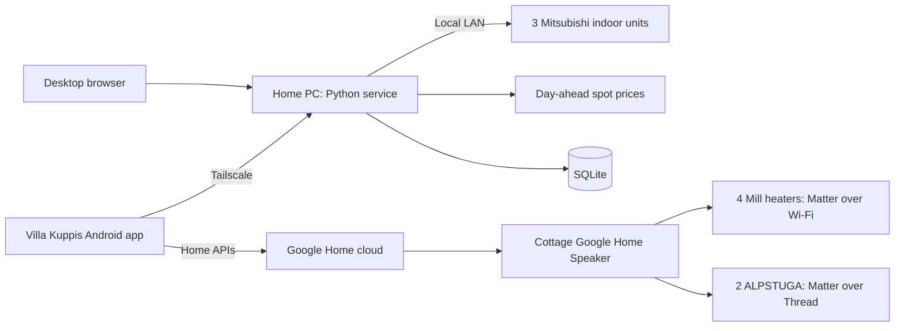

# Tentative architecture

## Decided

- One Python service on the owner's home Windows 11 PC, which is almost always on. No Home Assistant box, VM or cottage computer; those are a last resort.
- Finnish UI in a desktop browser and in a native Android app. All household phones are Android.
- Home: three Mitsubishi indoor units, controlled locally from the PC. Their main job is summer cooling; the apartment's radiators are geothermal and outside the owner's control. The home network is a Google Nest Wifi Pro.
- Cottage (devices arriving about early November 2026): four Mill heaters and two IKEA ALPSTUGA sensors, commissioned into Google Home over Matter, with the Google Home Speaker as hub. No Mill or IKEA app or cloud.
- Premium is not used: the speaker includes Standard, and Home MCP needs Advanced. See [platform decision](platform-decision.md).
- Spot-price automation with owner-defined rules is a high priority. See [spot-price automation](spot-price.md).

## Shape

The PC service owns configuration, history, rules and plans. It controls the pumps directly. It cannot reach Google Home, so the Android app carries cottage plans to Google as automations and reports cottage state back to the PC. Google's own app and [home.google.com](https://home.google.com) remain usable for manual cottage control.

## Stack

Python for the PC service: the leading pump route (`pymitsubishi`) is a Python library, and so is the ESPHome client for the CN105 fallback. Kotlin for the Android app. The service runs natively on Windows and starts at boot without an interactive login. The owner may still override the language choice before code lands.

## Model

Stable internal IDs for Site, Room, Device and Capability. Finnish display labels; language-neutral protocol identifiers. Store only capabilities a device actually reports.

Each reading has a value, a timestamp and a fresh/stale flag. Each command records who or which rule asked, the target, the requested value and its result: sent, confirmed or failed. Show the device's reported state and a pending request separately until the device confirms it. Use explicit set operations rather than toggles.

## Heating and cooling

Devices remain their own thermostats; the app only changes setpoints and modes. If the PC or internet is down, devices keep their last setpoint. The Mill heaters have built-in frost protection that does not depend on Wi-Fi, so the app needs no fallback of its own.

Plans use Europe/Helsinki local time; store timestamps in UTC.

## Remote access and security

[Tailscale](https://tailscale.com/pricing) connects the phones to the PC. Its free Personal plan should cover this: recent reports say it has allowed six users and unlimited personal devices since April 2026; confirm on the pricing page. Install it on the PC and each phone and sign in with the same account. Nothing is exposed to the public internet.

Keep the pump Wi-Fi adapters on the LAN only; published research describes weak security in their firmware. Keep credentials outside Git and back them up with the database.

No AI model is in the command path. Rules and plans are deterministic code.
